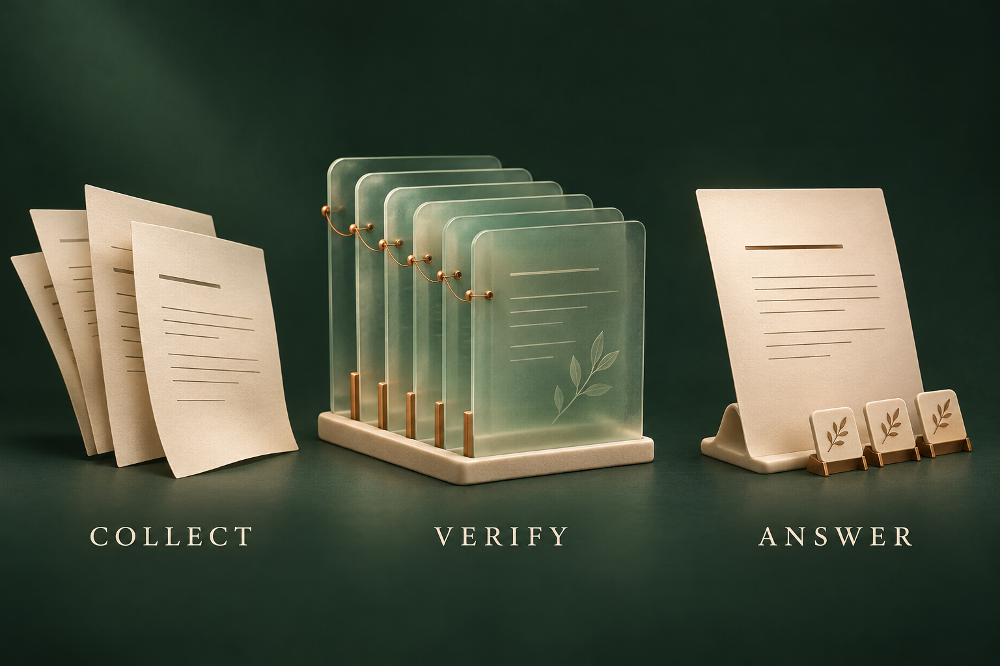

# Crawl_for_agent

**Collect the source. Keep the evidence. Answer with context.**

[English](README.md) · [简体中文](README.zh-CN.md) · [Capabilities](docs/CAPABILITIES.md) · [Architecture](docs/ARCHITECTURE.md) · [Usage](docs/USAGE.md)


*Concept illustration — not a screenshot of the application.*

Crawl_for_agent brings web collection, social-platform adapters, search, and source-grounded answers into one local research application and an agent skill. It integrates selected capabilities from [Crawl4AI](https://github.com/unclecode/crawl4ai) and [MediaCrawler](https://github.com/NanmiCoder/MediaCrawler) around a shared task runner, evidence store, browser/session lifecycle, and resource budgets.

This is an independent **source preview**, not an official upstream product, a drop-in replacement, or a claim of complete feature parity. The internal Python package and some commands retain the name `research_crawler`.

## A research workflow you can inspect

1. **Discover** URLs through search, site maps, or supported platform entry points.
2. **Collect** actual pages and records, preserving source identity, versions, and coverage.
3. **Answer** from saved evidence, with selected quotations and a separate support review.
4. **Resume or export** without silently turning failed sources into successful coverage.



*Concept illustration — the implementation and its limits are described in [Architecture](docs/ARCHITECTURE.md).*

The application preserves partial results when a request fails or a budget expires. An answer can contain supported conclusions while the task remains `partial`. Citations and model review improve traceability; they do not guarantee that every interpretation is correct.

## What is inside

| Area | Included capabilities |
|---|---|
| Web | HTTP and browser collection, HTML/Markdown, structured extraction, bounded site exploration, screenshots, cache import/export |
| Search and answers | Online discovery, local text search, optional multilingual semantic retrieval, answers linked to saved source passages |
| Platforms | Integrated adapters for Xiaohongshu, Douyin, Kuaishou, Bilibili, Weibo, Tieba, and Zhihu; operations vary by platform |
| Sessions | Explicit account selection, normal browser login, selected-site extension import, account/proxy pairing |
| Signing | Local signing or an authenticated loopback service for XHS, Douyin, and Zhihu; Kuaishou retains a browser dependency |
| Media and output | Media downloads, optional local OCR/transcription/vision, comment analysis, reports, file and database exports |

Optional model-based extraction, analysis, and image workflows require separately prepared runtimes and models. They are not prerequisites for every collection task.

## Platform research, with a defined scope


*Concept illustration — not a platform interface or an acceptance screenshot.*

The strongest recent authenticated evidence is a **bounded Xiaohongshu workflow**: search and detail collection, two root-comment pages, a creator listing, image downloads, a home feed using the signing service, and a real extension import followed by one successful detail request. Those samples do not establish exhaustive replies, every media variant, or future session validity.

Seven adapters in source do **not** mean seven platforms have passed every live workflow. Account/proxy allocation has local integration evidence; real platform traffic through a supplied proxy pool remains unvalidated. See the [capability and validation matrix](docs/CAPABILITIES.md).

## Answers and operating costs

New standalone answer tasks currently default to the **existing ChatGPT/Codex account through Codex CLI**, using saved source context. This needs network access and consumes the account's available allowance. It does not require an OpenAI API key, does not silently fall back to a paid API, and is **not unlimited, free, or fully offline**.

Inside an existing Codex conversation, the skill can combine the host's available search tools with saved collection results and answer in that conversation. Host tools are not bundled standalone search APIs. Experimental local text-model routes remain available when configured; their semantic quality has not met the same acceptance bar.

## Running this source preview

The existing configured **Windows environment** has been exercised. A clean installation from this public snapshot has not yet been accepted; Linux/macOS support is not claimed from the Windows results.

The snapshot omits runtimes, browser binaries, model weights, local state, account sessions, tokens, private configuration, and collected research data. Prepare the required dependencies and selected optional components before using the project launchers. A repository clone alone is not a ready-to-run bundle.

See [Windows source setup](docs/GETTING_STARTED.md) for prerequisites and preparation commands, and the [portable Skill template](skill/research-crawler/SKILL.md) for agent integration. Once configured, the PowerShell entry points are:

```powershell
# Inspect configured components; this does not install them.
.\scripts\research.ps1 status
.\scripts\research.ps1 doctor

# Open the local worktable service.
.\scripts\start-research.ps1
```

The default worktable address is `http://127.0.0.1:8946`. Keep the service local. Use [Usage](docs/USAGE.md) for task examples and the distinctions between login, import, and collection.

## Relationship to upstream and licensing

- This project uses source-level integration and shared ownership of overlapping functions. A source-disposition index is not proof of full upstream behavioral equivalence.
- Public [MediaCrawlerPro](https://github.com/MediaCrawlerPro) descriptions informed selected independently implemented features. No private Pro implementation or protocol compatibility is claimed; this is **not a full Pro replacement**.
- Preserve upstream notices and component licenses. **MediaCrawler-derived components carry non-commercial restrictions**; do not treat the combined snapshot as an unrestricted commercial-use package. Review the included license and third-party notices before reuse or redistribution. Individual models and other dependencies have their own terms.
- The project is not affiliated with, endorsed by, or an official client of the supported platforms. Use accounts and content you are authorized to access. Login challenges and access failures remain visible; the application does not promise to defeat them.

## Current boundaries

Public search and platform endpoints can reject or rate-limit requests. Some login probes cannot conclusively determine account validity. Recent signing/pool controls have implementation and bounded API evidence, not a complete visual-interaction audit. Long screenshots passed bounded complete and capped worktable cases; an older standalone diagnostic-process exit remains unexplained. Local model quality and arbitrary image-editing fidelity are not general guarantees.

For the exact difference between **implemented**, **locally checked**, and **live-sampled**, start with [Capabilities](docs/CAPABILITIES.md).

## Credits and publication

This product includes software developed by UncleCode (https://x.com/unclecode) as part of the Crawl4AI project (https://github.com/unclecode/crawl4ai). MediaCrawler source copyright its authors, including relakkes@gmail.com, remains under NON-COMMERCIAL LEARNING LICENSE 1.1.

[License terms](LICENSE.md) · [Attribution](NOTICE.md) · [Source provenance](docs/PROVENANCE.md) · [Artwork and prompts](docs/ARTWORK.md)
