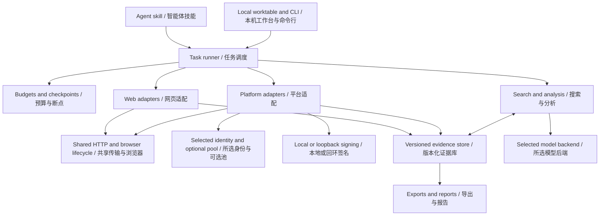
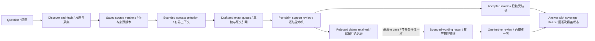

# Architecture / 架构

[English overview](../README.md) · [中文概览](../README.zh-CN.md) · [Capabilities](CAPABILITIES.md)

## One application, shared ownership / 一个程序，共享组件

The integration centralizes task state, persistence, budgets, sessions, and resource ownership. Platform adapters and web collection use that common core instead of running two unrelated upstream applications. The optional signing service is a component of the same project; it calculates signatures and does not fetch platform content.

整合的核心是统一任务、存储、预算、会话及资源归属。网页与平台适配使用共同基础设施，不是同时运行两个互不关联的上游程序。可选独立签名服务仍属同一项目，只计算签名，不代发平台采集请求。

## Evidence before answers / 先有证据，再作回答

Search results identify candidates; they are not substitutes for fetched text. Saved records retain the source URL, content/version identity, field and range coverage where applicable. Answers select quotations from those records. A separate review checks each claim against its own selected supports; shared context can expose conditions or counterexamples, but cannot supply unselected positive support.

搜索结果用于发现，不替代实际正文。记录保留 URL、内容版本身份及适用的字段/读取范围。回答从这些记录选取引文，再逐条审核结论。共享上下文可帮助发现条件或反例，不能拿未选引文补足正向依据。

Repair does not widen the selected sources or run indefinitely. Reviewed progress is retained across controlled budget interruption. Answer reuse on resume requires matching question, source versions/ranges, backend identity, and generation/review contracts. Coverage failure can keep the overall task partial even when some claims are accepted.

修正不能扩大选定来源，也不无限循环。受控预算中断保留已审核进度；恢复复用须匹配问题、来源版本/范围、后端身份及生成/审核协议。部分结论已接受，整体来源覆盖仍可能是 partial。

## Account boundary / 账号边界

Normal login saves a user-selected session. CookieBridge is a separate, explicit import path: the real toolbar captures the source tab/store, a persistent extension page requests the selected site's permissions, and a one-use local pairing transfers the supported cookie subset. Temporary permissions are removed after the attempt. It neither scans other browser profiles nor transfers general application credentials to the extension.

正常登录保存用户选择的会话；CookieBridge 是独立的显式导入入口：真实工具栏捕获来源页/容器，持久扩展页申请所选站点权限，通过一次性本机配对传输支持的 Cookie 子集，最后撤回临时权限。不扫描其他浏览器配置，也不向扩展提供通用应用凭据。

Pool tasks pin one account/proxy pair and snapshot it for the task. Authentication failure does not silently switch identity. Local secret protection is Windows-specific in the validated environment; database contents and run artifacts still require appropriate local handling.

池任务固定账号与代理配对，并使用任务内身份快照。鉴权失败不会静默换号。已验证环境中的私密状态保护使用 Windows 机制；研究库与运行产物仍须妥善保管。

## Resource and backend choices / 资源与后端

- CPU semantic retrieval and optional GPU model work use coordinated, bounded workers. Optional features are not all loaded for ordinary collection.
- The Codex backend uses an existing ChatGPT login, network access and account allowance. Its CLI output-token request is a soft budget, not a verified API-equivalent hard token limit.
- The loopback signing service adds authentication, concurrency and time/input limits, but per-call worker startup has overhead. Separation is not a throughput claim.
- Browser cleanup applies to task-owned resources. Borrowed external browser contexts retain separate ownership rules.

CPU 语义检索与可选 GPU 模型通过共享协调与预算执行；普通采集不要求加载全部可选模型。Codex 使用账号、网络与额度，其 CLI 输出 token 要求属于软预算。签名服务具有认证和限额，但逐次 worker 启动有额外成本，不宣称提速。浏览器清理仅作用于任务拥有的资源，借用外部上下文遵循独立归属规则。

This architecture describes the integrated design, not a distributed deployment benchmark or a guarantee of model truthfulness. Consult [Capabilities](CAPABILITIES.md) before extending its acceptance claims.

这份架构描述不等于分布式部署基准，也不保证模型结论正确；实际验收范围以[能力矩阵](CAPABILITIES.md)为准。
