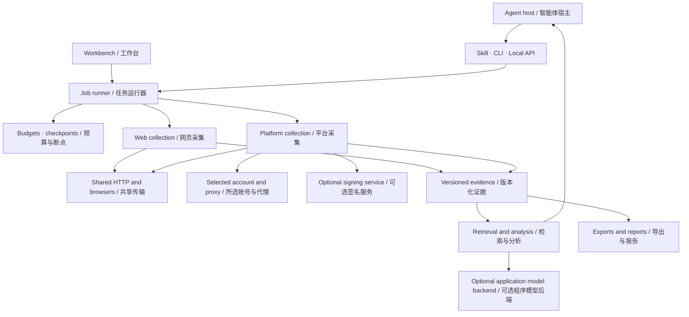
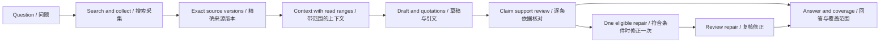

# Architecture / 架构

[Overview](../README.md) · [中文概览](../README.zh-CN.md) · [Agent integration](AGENT_INTEGRATION.md) · [Capabilities](CAPABILITIES.md)

## A task-centered research system / 以任务为中心的研究系统

Crawl_for_agent organizes collection, retrieval, analysis, and exports around one task runtime. Each task has explicit sources, an identity, budgets, durable progress, and an observable outcome. Web and platform adapters share the same storage and resource lifecycle.

Crawl_for_agent 以统一任务组织采集、检索、分析与导出。每项任务都有明确来源、身份、预算、持久进度和可查看的结果；网页与平台适配共享存储及资源生命周期。

The application owns scheduling and evidence persistence. Its adapters include attributed source-derived algorithms as well as project-specific components; component origins and licenses are recorded in [Provenance](PROVENANCE.md).

程序负责调度和证据持久化。适配器包含保留署名的源算法及项目自有组件，具体来源和许可见[源码溯源](PROVENANCE.md)。

## Research library / 研究资料库

[Artwork notes / 插画说明](ARTWORK.md)

Collected records retain their URL, content version, observation time, and available source date. Text extraction and analysis carry field/range references where applicable. Derived Markdown, labels, model descriptions, and answer drafts remain distinguishable from original content.

采集记录保留 URL、内容版本、观测时间及来源提供的日期；文本提取和分析按适用情况保存字段及原文范围。派生 Markdown、标签、模型描述和回答草稿与原始内容明确区分。

This supports three useful operations: retrieve previous material, trace a conclusion to its source, and resume a task without discarding its earlier work. Exports preserve selected records and their provenance.

因此可以复用已有资料、沿结论回查来源，也可以从断点继续任务。导出保留所选记录与出处信息。

## From sources to answers / 从来源到回答

An agent host can collect sources and answer in its own conversation. Alternatively, the application's research handler performs a persisted generation-and-review workflow. [Agent integration](AGENT_INTEGRATION.md) explains the configuration of both routes.

智能体宿主可以采集后直接在当前对话回答；程序的研究处理器也可以执行持久化的生成与审核流程。两条路线的配置见[智能体接入](AGENT_INTEGRATION.md)。

Each claim is checked against its selected quotations. Additional source context helps identify qualifications and contradictions. Rejected claims and incomplete coverage remain visible. A repair uses the same selected sources and a bounded additional review.

逐条结论使用其选定引文接受核对，补充上下文用于识别条件和矛盾。被拒结论及未覆盖部分保留记录；修正沿用选定来源，并受额外审核次数限制。

Resume reuses an eligible reviewed answer when the question, source versions/ranges, backend identity, and generation/review contracts still match. Controlled budget interruption preserves reviewed progress.

问题、来源版本与范围、后端身份、生成及审核契约一致时，恢复可复用已审核答案。受控预算中断保留已审核进度。

## Identity and resource lifecycle / 身份与资源生命周期

Normal login saves a selected platform session. CookieBridge provides an alternative user-authorized import from a selected browser site/store through one-use local pairing. Temporary site permissions are removed after the attempt. Account/proxy pools pin a pair and snapshot it for the task; authentication failure stops that identity's work rather than switching accounts.

普通登录保存所选平台会话；CookieBridge 通过用户授权及一次性本机配对，从选定浏览器站点／容器导入会话，并在结束后撤回临时权限。账号代理池为任务固定配对与身份快照；鉴权失败时停止该身份的工作。

HTTP clients, owned browser contexts, page/request limits, and cancellation are coordinated by the shared task runtime. Borrowed browsers retain their external ownership. CPU retrieval and optional GPU work load resources when needed; model jobs use a shared resource coordinator. The optional loopback signing service performs signature computation while the task's HTTP client remains responsible for collection.

HTTP 客户端、自有浏览器上下文、页面／请求限制及取消由任务运行器统一管理，借用浏览器保留外部归属。CPU 检索与可选 GPU 工作按需加载资源，模型任务通过共同协调器执行。可选回环签名服务只计算签名，采集仍由任务 HTTP 客户端执行。

See [Capabilities](CAPABILITIES.md) for current platform samples, model-quality observations, and environment coverage.
