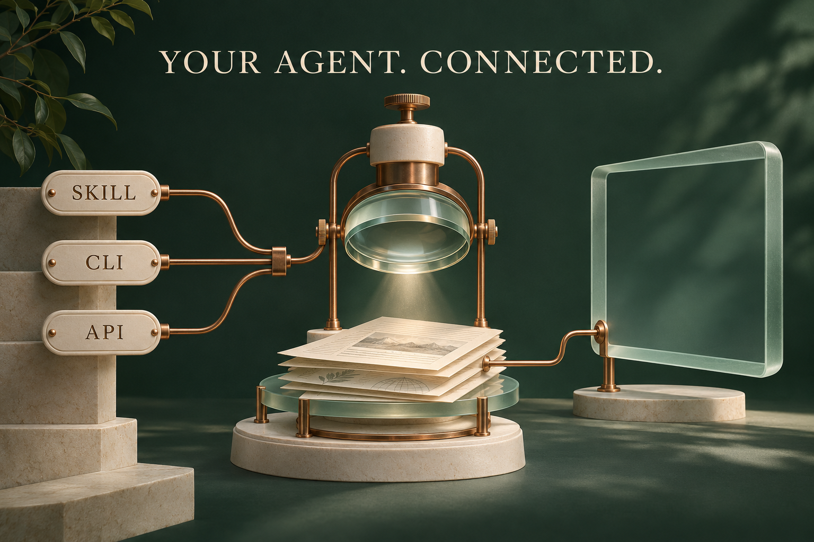
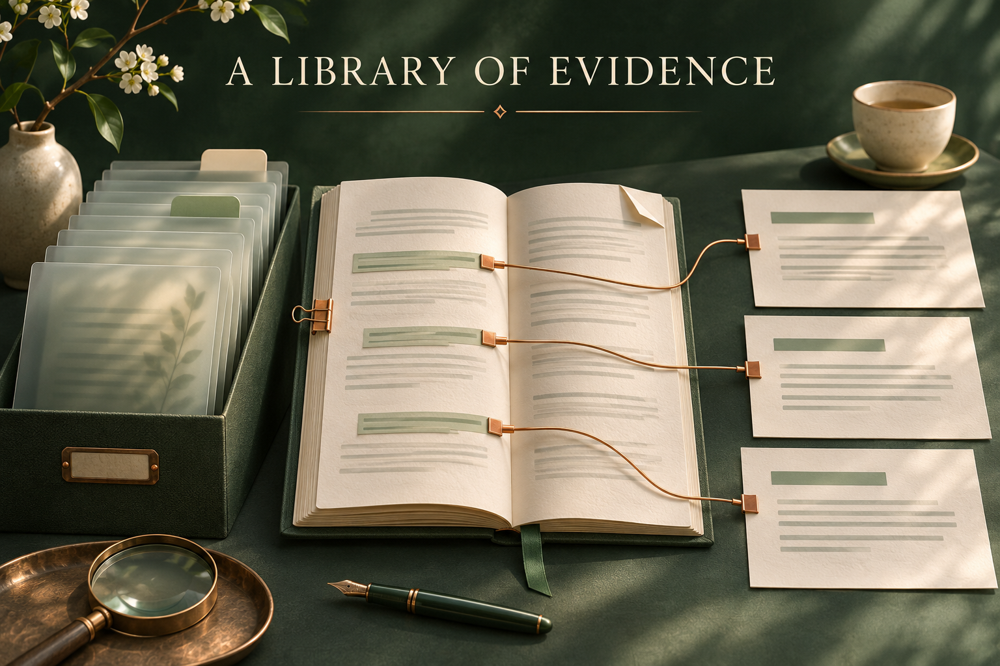
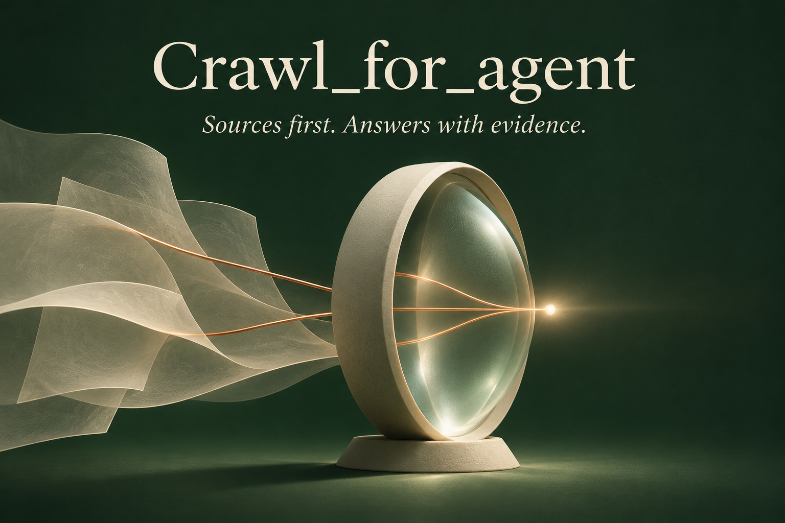
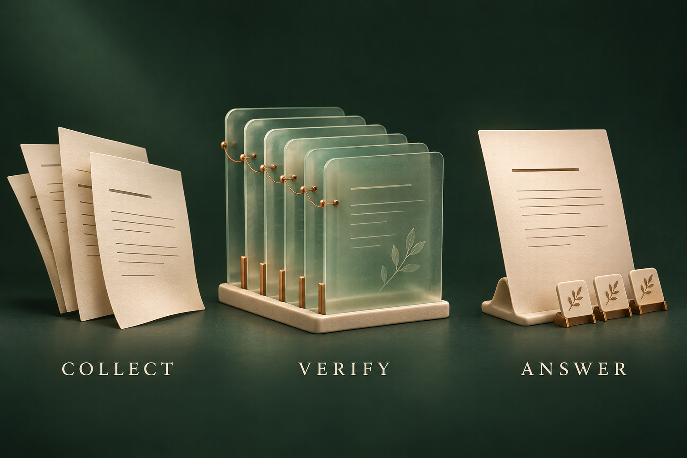
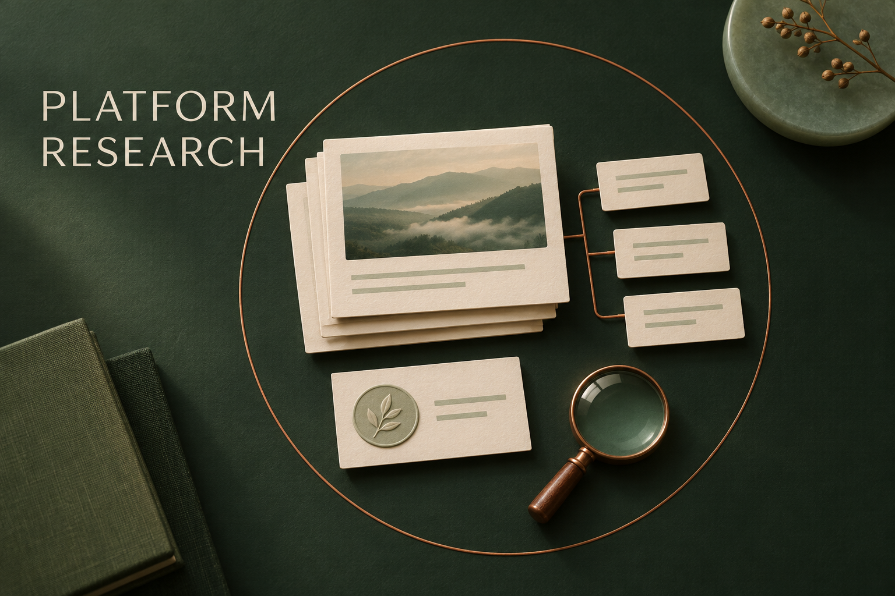

# Generated concept artwork / 生成概念配图

Five images generated with the built-in image-generation tool on 2026-11-07. The collection illustrates the project identity, research workflow, platform content, agent integration, and evidence library. These are concept illustrations rather than application screenshots or exact architecture diagrams. Original generated PNGs are used without image editing. The tool does not expose a selectable model identifier.

2026-11-07 使用内置生图生成五张配图，分别呈现项目定位、研究流程、平台内容、Agent 接入和证据资料库。统一采用深绿、象牙白、磨砂玻璃与铜色细节。图片为概念插画，区别于产品截图和精确架构图；工具未提供可选择的模型编号。

## agent-harness

Prompt:

> Create an exquisite editorial concept illustration for the Agent Harness integration section of Crawl_for_agent. Landscape 1536x1024, matching a research-instrument series: deep evergreen studio backdrop, warm ivory ceramic, frosted pale jade glass, thin antique copper connectors, restrained Swiss editorial composition and soft tactile lighting. A small beautifully crafted central research instrument, shaped like a vertical optical lens over an orderly stack of evidence sheets. Three distinct connector pieces approach it from the left, subtly engraved with exactly 'SKILL', 'CLI', 'API'. On the right, a single elegant open glass frame represents the host agent's reasoning workspace, connected to the same evidence sheets. The visual tells a clear story of one research engine connecting into agent workflows, NOT a fabricated app interface. No vendor logos, no robots, no fake screens, no miniature dashboard text, no metric badges, no claims of automatic compatibility. Ample negative space; graceful precise geometry, richer layering than a generic icon. The only heading is 'YOUR AGENT. CONNECTED.' in immaculate warm-ivory type near the top. Make the copper paths understandable and non-chaotic, museum-quality materials, premium journal spread.

## research-library

Prompt:

> Generate a sophisticated editorial concept illustration of a personal research evidence library for Crawl_for_agent documentation, landscape 1536x1024. Continue a cohesive visual identity of deep forest-green, warm ivory paper and ceramic, pale jade frosted glass, tiny antique copper details. A precise tabletop still life with an elegant archive of translucent source folios on the left, a carefully opened notebook with abstract source passage lines in the center, and three clean report sheets arranged on the right. Fine copper index clips visibly connect selected source passages to the report sheets, making traceability intuitive. One little folded corner and two subtle tab dividers add human craft and richness. Tactile light, calm depth, sophisticated physical realism, plenty of space, beautiful shadows, editorial art direction worthy of a finely designed research monograph. Heading, exactly: 'A LIBRARY OF EVIDENCE'. No other readable text, no numbers or claims, no application UI, no logos, no citations to real people, no robots. This is a concept illustration of saved sources and reusable research outputs, not a screenshot or architecture diagram.

## hero

Prompt:

> Create a premium editorial technology illustration for the GitHub README of Crawl_for_agent, a local web research and collection tool for AI agents. Landscape 1536x1024 composition with an expansive dark forest-green background, ivory translucent layers resembling sheets of source material, a sculptural central lens or aperture gathering a few fine copper threads of evidence into one precise luminous point. Minimal Swiss editorial art direction, refined matte ceramic and frosted glass materials, beautiful physical light and subtle film grain, disciplined negative space, striking clear silhouette, no generic robot, no circuit board wallpaper, no decorative UI widgets, no screens, no platform logos. Restrained palette dark evergreen, warm ivory, antique copper, very subtle jade highlights. Main text typeset impeccably and large: 'Crawl_for_agent'. Smaller subtitle only: 'Sources first. Answers with evidence.' Make it look like an original museum-quality research instrument visual and sophisticated open-source project cover. This is conceptual artwork, not a screenshot or technical architecture diagram. No other text, no watermarks. Keep content comfortably inset from image edges.

## evidence-flow

Prompt:

> Generate a beautiful premium editorial conceptual illustration for a GitHub research software README, landscape 1536x1024. Three clearly separated sculptural groups arranged from left to right: several thin ivory source sheets with subtle ink lines, then a carefully ordered archive of translucent glass folios with tiny copper connection threads, then a single elegant ivory answer sheet accompanied by three small evidence markers. The visual metaphor is collecting sources, preserving evidence, producing supported answers. No exact data or UI. Deep forest-green studio background, warm ivory matte ceramic, pale jade frosted glass, fine antique copper accents, same disciplined Swiss editorial design as a luxury research-instrument publication. Gentle perspective, highly legible silhouette at small sizes, generous space, precise rich lighting, tactile surfaces, beautifully restrained details. Put just three elegant short labels below the groups: 'COLLECT', 'VERIFY', 'ANSWER'. No additional text, no numeric metrics, no logos, no arrows implying a specific technical implementation, no robots, no cybersecurity neon cliches, no watermarks. Artistic concept image, not a real interface.

## platform-research

Prompt:

> Create a refined conceptual illustration for the platforms and community research section of Crawl_for_agent GitHub documentation. Landscape 1536x1024. An arranged still life of ivory editorial note cards, one card with an abstract photographic landscape inset, a short chain of small comment cards, and a quiet circular author medallion, all contained on a precise dark green desk with a thin copper circular boundary. Suggest a careful bounded sample of posts, comments and creators rather than surveillance or mass harvesting. One small magnifying lens resting beside the selected cards. No faces, no personally identifying text, no social network logos, no invented product interface or dashboard. Dark evergreen, warm ivory, frosted pale jade, antique copper palette, matte physical materials, soft directional studio illumination, beautiful shadows and editorial Swiss restraint. Minimal clean composition, rich tactile realism, generous negative space, sophisticated museum-quality research apparatus aesthetic matching an evidence-first software cover. Only text: 'PLATFORM RESEARCH' in impeccable large restrained typography. No other copy or metrics or watermarks.

